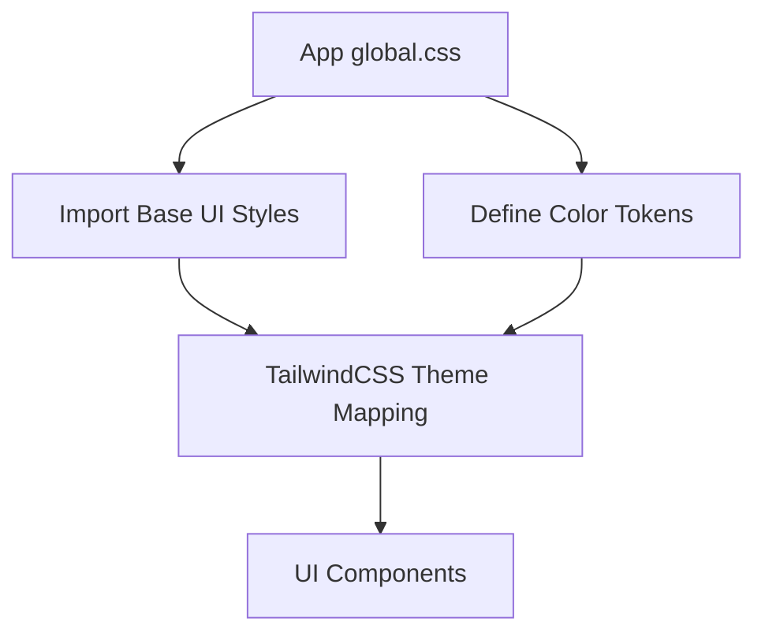

# UI Package Theming System

This document explains how to use the theming system across multiple apps in your monorepo.

## Overview

The theming system consists of:

- **Base styles** (`src/styles/globals.css`) - Provides the theming framework
- **App-specific themes** - Define color tokens for each app
- **Theme template** (`src/styles/theme-template.css`) - Starting point for new apps

## Architecture



## How It Works

1. **Apps define color tokens** in their `global.css`:

   ```css
   :root {
     --background: #ffffff;
     --primary: #0070f3;
     /* ... other colors */
   }
   ```

2. **Base UI maps tokens to Tailwind** via `@theme inline`:

   ```css
   @theme inline {
     --color-background: var(--background);
     --color-primary: var(--primary);
     /* ... */
   }
   ```

3. **Components use Tailwind classes**:
   ```tsx
   <div className="bg-background text-foreground border-border">
     <button className="bg-primary text-primary-foreground">Click me</button>
   </div>
   ```

## Setting Up a New App

### Method 1: Copy Template

1. Copy `packages/ui/src/styles/theme-template.css` to your app
2. Rename it to `global.css` (or your preferred name)
3. Customize the color values
4. Import it in your app's layout

### Method 2: From Scratch

1. Create a new CSS file in your app
2. Add the base import at the top:
   ```css
   @import "../../../packages/ui/src/styles/globals.css";
   @source "../../../packages/ui/src/styles/globals.css";
   ```
3. Define your color tokens in `:root` and `.dark` selectors
4. Import the file in your app

## Required Color Tokens

### Core Colors

- `--background` - Main app background
- `--foreground` - Main text color
- `--primary` - Primary brand color
- `--primary-foreground` - Text on primary
- `--secondary` - Secondary surfaces
- `--secondary-foreground` - Text on secondary

### UI Component Colors

- `--card` - Card backgrounds
- `--card-foreground` - Card text
- `--popover` - Popover backgrounds
- `--popover-foreground` - Popover text

### State Colors

- `--muted` - Muted backgrounds
- `--muted-foreground` - Muted text
- `--accent` - Accent surfaces
- `--accent-foreground` - Text on accent
- `--destructive` - Error states
- `--destructive-foreground` - Error text

### Form Colors

- `--border` - Border color
- `--input` - Input borders
- `--ring` - Focus rings

### Optional Colors

- `--chart-1` through `--chart-5` - Chart colors
- `--sidebar-*` - Sidebar component colors
- `--radius` - Border radius

## Dark Mode

Define overrides in a `.dark` selector:

```css
.dark {
  --background: #0a0a0a;
  --foreground: #fafafa;
  /* ... override other colors */
}
```

## Example: Current Webshop App

```css
/* Import base framework */
@import "../../../packages/ui/src/styles/globals.css";

/* Define webshop-specific colors */
:root {
  --background: #dc2626; /* Red theme */
  --foreground: #252525;
  --primary: #343434;
  /* ... */
}

.dark {
  --background: #dc2626; /* Keep red in dark mode */
  --foreground: #fafafa;
  /* ... */
}
```

## Best Practices

1. **Import base styles first** - This establishes the framework
2. **Use semantic color names** - Stick to the defined token names
3. **Test both light and dark modes** - Ensure good contrast
4. **Document custom colors** - Add comments for app-specific choices
5. **Follow SOLID principles** - Keep themes focused and maintainable

## Troubleshooting

### Colors not applying

- Check import order (base styles should be imported first)
- Verify CSS custom property names match exactly
- Ensure no typos in color values

### Dark mode not working

- Make sure you have a `.dark` selector with overrides
- Check that your theme toggle is adding/removing the `dark` class
- Verify dark mode color values have good contrast

### Missing colors

- Check that all required tokens are defined
- Look for console errors about undefined CSS variables
- Compare against the theme template

## Adding New Color Tokens

1. Add the token to your app's `:root` and `.dark` selectors
2. Map it in the base `@theme inline` block:
   ```css
   --color-your-new-token: var(--your-new-token);
   ```
3. Update the theme template for future apps
4. Document the new token in this README
